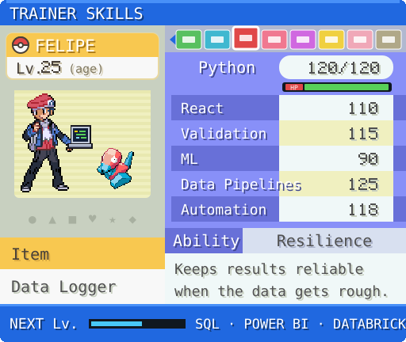
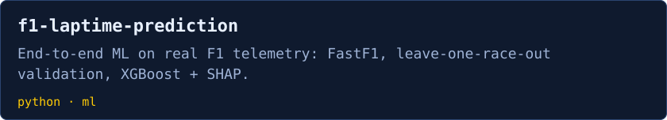
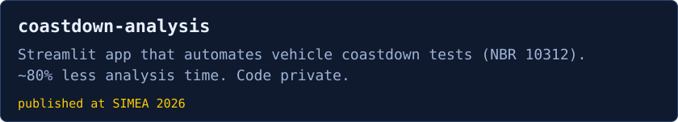
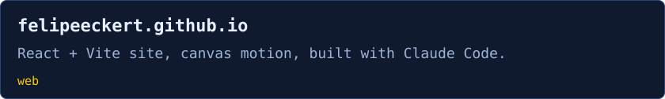

  

  
  
  
  

- R&D data analyst at **Hyundai Motor Brasil** (Energy Efficiency & Data Analytics): I build Python tools that process, validate, and report vehicle test data.
- Electrical Engineer from **Poli-USP**. Six years on the **BAJA SAE** team, where telemetry data drove our design decisions.
- I care about the parts of analytics that keep results reliable: clear validation rules, repeatable pipelines, and reports people actually use.
- Currently leveling up **SQL** and **Power BI**; next up: **Databricks**.
- Portuguese (native) · English (C1) · Spanish (B1)

  

  
  
  
  
  
  
  
  
  
  
  

**Automotive tooling:** CAN bus (Vector CANalyzer/CANoe) · Bosch ETAS INCA · VBOX GPS data acquisition · chassis dynamometer and coastdown testing

- **[2026]** 1st place, **Hyundai Prompt-a-thon**: an *R&D Automotive Intelligence Hub* on Microsoft 365 Copilot that consolidates multi-source information into executive reports.
- **[2026]** Paper at XXXIII SIMEA: **[Data-Driven Coastdown Analysis: Automated Data Processing and Predictive Modeling for Vehicle Road Load and Energy Efficiency Assessment](https://doi.org/10.5151/2357-7592-PAP126)**. J. W. P. Silva, F. A. Eckert · *Blucher Engineering Proceedings, vol. 13, pp. 760–768*
- **[2023]** Undergraduate thesis, Poli-USP: **[Sistema de aquisição de dados para protótipos off-road](https://www.researchgate.net/publication/411876977_Escola_Politecnica_da_Universidade_de_Sao_Paulo_Sistema_de_aquisicao_de_dados_para_prototipos_off_-road)** (data acquisition system for off-road prototypes)

More on [ResearchGate](https://www.researchgate.net/profile/Felipe-Eckert-2/research).

  

Pixel sprites from <a href="https://github.com/PokeAPI/sprites">PokeAPI/sprites</a> and Pokémon Showdown (Lucas, edited). Pokémon © The Pokémon Company, Nintendo, Game Freak. Fan-made, non-commercial. Font: Pixelify Sans (OFL).

