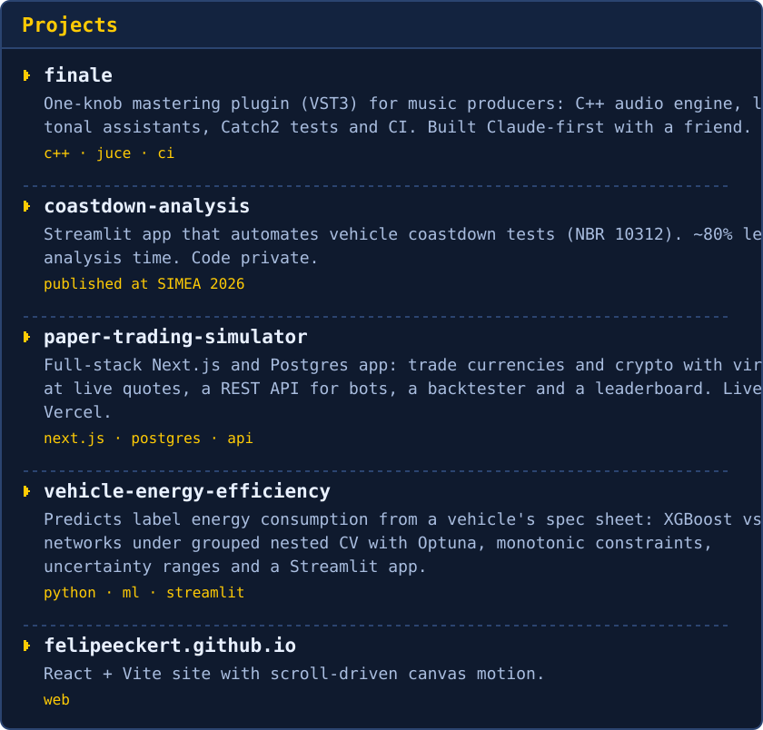
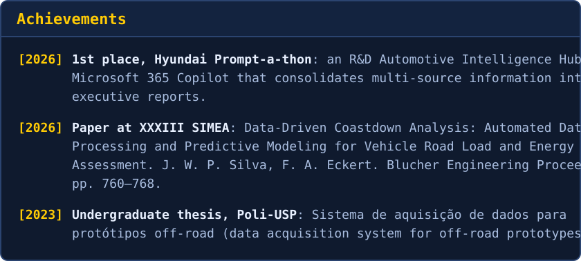

  

  
  
  
  

  
  
  
  

  
  
  

  

Pixel sprites from <a href="https://github.com/PokeAPI/sprites">PokeAPI/sprites</a> and Pokémon Showdown (Lucas, edited). Pokémon © The Pokémon Company, Nintendo, Game Freak. Fan-made, non-commercial. Font: Pixelify Sans (OFL).

